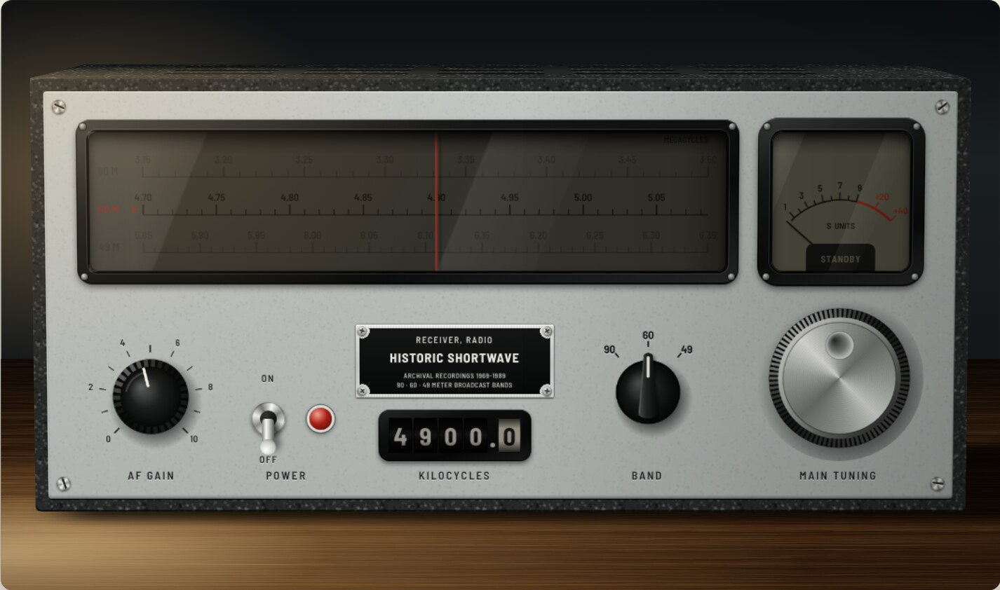

# Historic Shortwave

A simulated shortwave receiver that plays archival broadcast recordings from 1969 to 1989 at the frequencies where they were originally heard. Tune the 90, 60 and 49 meter bands, listen for a station identification, then reveal the station's name, location and recording credit.

**Live site:** https://historicshortwave.org/



The site is a static web page with no server code. It sets no cookies, stores nothing in the browser and loads no third-party scripts. The recordings stream directly from the Internet Archive and are not included in this repository. No rights clearance is implied by this repository.

## Repository layout

| Path | What it holds |
|---|---|
| `release/heritage-hr64-face/` | The site as published: the current receiver face. Generated by `tools/build-face.py`; do not edit by hand. |
| `release/heritage-hr64/` | The earlier grey-panel release, which the face build starts from. Generated by `tools/build-release.py`; do not edit by hand. |
| `app/heritage-h60/` | The development receiver that the release builds are made from. |
| `tools/` | Build scripts, data tools and tests. |
| `tools/face-overlay/`, `tools/release-overlay/` | Page, style and texture files that the build scripts layer onto the release. |
| `data/` | Catalogs, rights records and metadata that the builds read. |
| `docs/` | Images for this README. |

## Running the site locally

The published site needs nothing but a static file server. With Python 3 installed:

```
cd release/heritage-hr64-face
python3 -m http.server 8766
```

Then open http://localhost:8766/ in a browser. Playback needs an internet connection, because the recordings stream from archive.org.

## Building the release

The release folders are generated from `app/heritage-h60/`, the overlays in `tools/` and the rights list in `data/release/`. Rebuild them in this order:

```
python3 tools/build-release.py
python3 tools/build-face.py
```

Both scripts use only the Python standard library. After a rebuild, `git status` should show no changes to `release/` unless you changed a source file.

## Tests and checks

Data and logic tests need Node.js 18 or later:

```
node tools/test-band-catalogs.cjs
node tools/test-full-inventory.cjs
node tools/test-reveal-geography.cjs
node tools/test-seasonal-noise.cjs
```

The pre-publish check confirms that a folder holds only site files: no stray email addresses or outside scripts, a security policy that matches the approved audio hosts, and self-hosted fonts.

```
HR64_APP=release/heritage-hr64-face python3 tools/check-publish-ready.py
HR64_APP=release/heritage-hr64-face python3 tools/test-publish-check.py
```

The browser tests (`tools/test-*.py` other than `test-publish-check.py`) drive the page in Chromium through Playwright. Install Playwright with `python3 -m pip install playwright` and `python3 -m playwright install chromium`, or pass your own browser with `--chrome PATH`. Most of them test the release face when run with `HR64_APP=release/heritage-hr64-face`; each script's opening comment gives its exact command.

The other scripts in `tools/` rebuild catalogs, maps, credits and the seasonal static from source data. Some of them need extra packages (`openpyxl`, `numpy`, `pyshp`) or `ffmpeg`, and some download source data. Each script's opening comment says what it reads and writes.

## Licensing

- Code: MIT License, except the material listed in `LICENSE`.
- Receiver face code, stylesheets and textures: CC BY 4.0, with attribution to William J. Martin. See `ASSETS.md`.
- Third-party data, fonts and libraries keep their own licenses. See `NOTICE.md`.
- The Historic Shortwave name and logo are trademarks. See `TRADEMARK.md`.
- To contribute recordings or corrections, see `CONTRIBUTING.md`.
- To report a security problem, see `SECURITY.md`.
